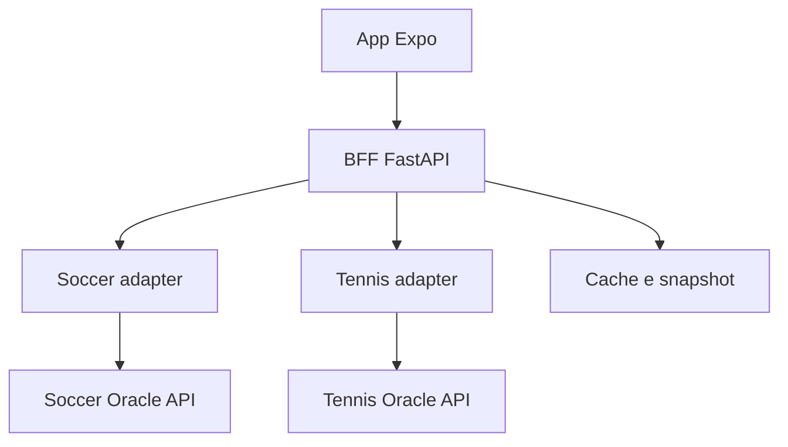

# Architettura proposta



L'app conosce soltanto l'URL BFF. Il BFF chiama le due API via HTTPS, valida le response, mappa eventi e predizioni, applica filtri e restituisce un contratto stabile. Non importa package interni dei repository ML e non usa i loro database. Nessuna libreria condivisa da estrarre nella fase iniziale: accoppierebbe deployment indipendenti.

## Repository suggerito

```text
Sport_IAppero/
  docs/
  contracts/
  evidence/
  backend/
    app/
      main.py
      api/v1/               # sports, feed, events, predictions
      core/                 # config, errori, logging
      schemas/              # modelli provider e modelli unificati
      providers/
        base.py
        soccer/             # client.py, schemas.py, mapper.py
        tennis/             # client.py, schemas.py, mapper.py
      services/             # aggregazione, cache, ranking
      repositories/         # snapshot, solo dalla fase persistenza
    tests/fixtures/
    Dockerfile
    .env.example
  mobile/
    app/                    # Expo Router
    src/api/
    src/components/
    src/types/
    src/theme/
```

Protocollo interno: `list_events(query) -> ProviderBatch`, `list_predictions(query) -> ProviderBatch`. Detail inizialmente ricavato dalla cache del feed, evitando chiamate costose per ogni evento. ProviderBatch include eventi, predizioni, stato, timestamp, completezza e warning. Per estendere a uno sport aggiungere adapter, mapping mercati e capability senza cambiare la logica degli altri adapter.

## Resilienza

Usare un client `httpx.AsyncClient` condiviso con pooling. Richieste provider concorrenti, deadline complessiva e risultati indipendenti. Default proposti: connect 3s, read 8s, deadline feed 10s, cache fresh 60s e stale massimo 300s. Sono configurabili, da tarare con misure reali. Per la richiesta utente nessun retry se eccede la deadline; retry limitato solo su errori temporanei in aggiornamento background. Mai retry di 401/403/422. Rispettare 429 e Retry-After.

Cache per provider, data, mercato e modello; includere lingua solo se cambia il payload. Single-flight per chiave: richieste simultanee condividono un fetch. Cache memoria ammessa in locale; con più repliche usare cache/snapshot condivisi. Non far partire training o refresh per riempire il feed. Non trasformare un provider guasto in sport con zero eventi senza segnalarlo.

Rilasciare 200 se almeno un provider richiesto risponde, anche vuoto; metadati separano complete/degraded/empty. Se nessuno è utilizzabile e non esiste cache valida, 503. Non chiamare endpoint amministrativi attraverso un proxy generico.
